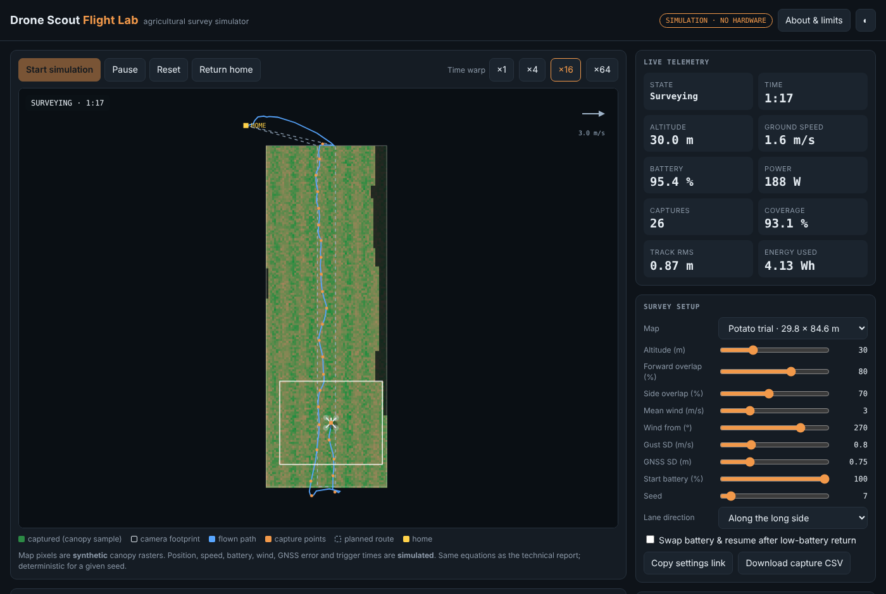
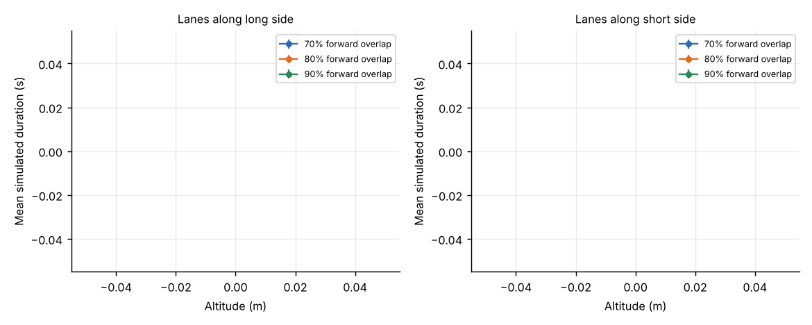
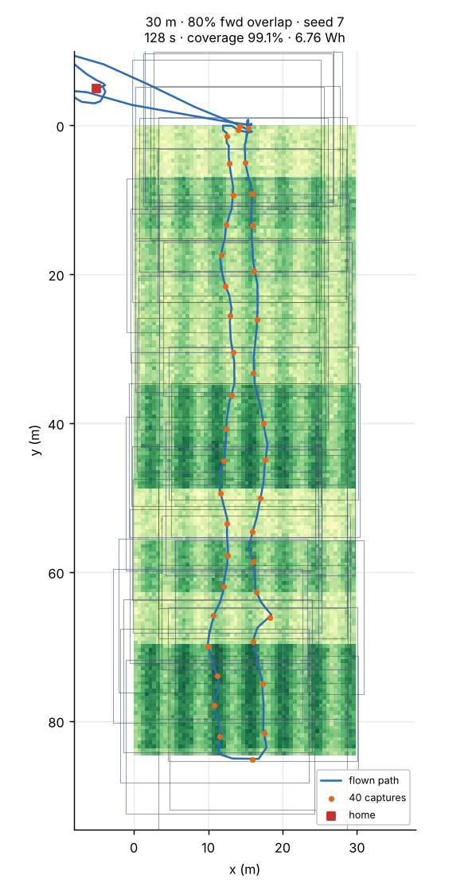
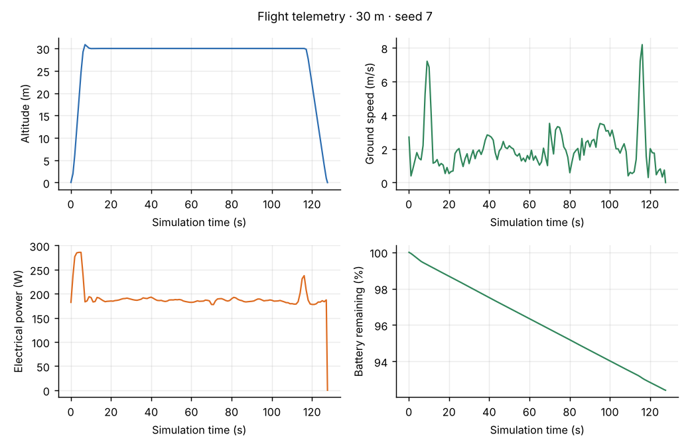
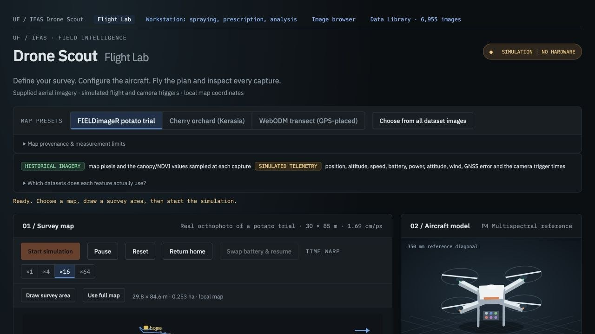
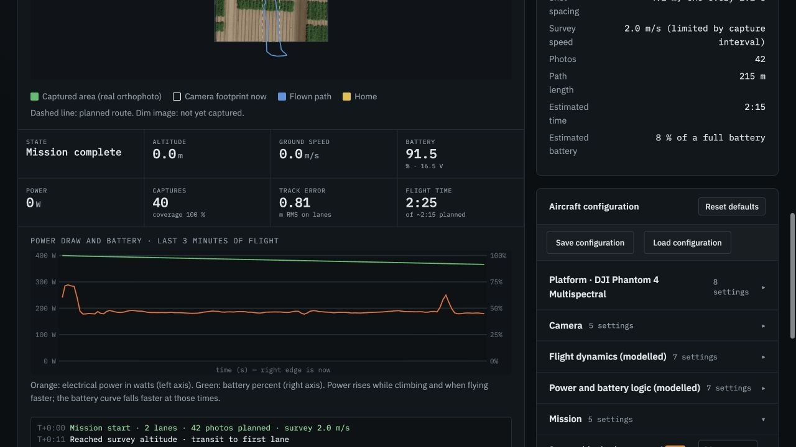
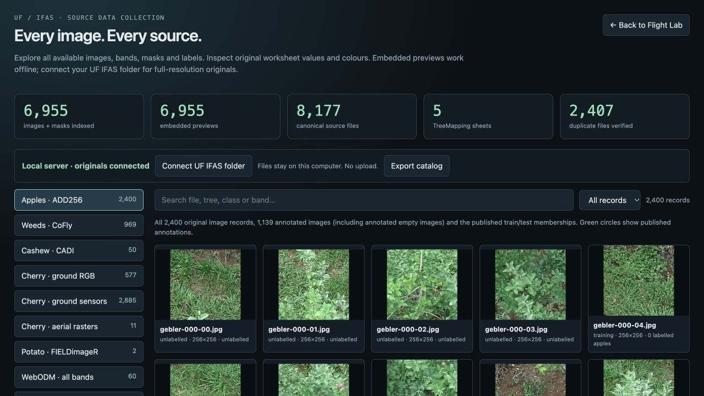

<div align="center">

# Drone Scout

**Provenance-aware agricultural UAV survey simulation: plan a lawn-mower survey, fly it through wind and GNSS noise, and see exactly what the aircraft would have captured.**

[](LICENSE)




[Try the simulator](web/index.html) · [Read the technical report](docs/Drone_Scout_Technical_Thesis_Report.pdf) · [Reproduction check](docs/REPRODUCTION.md)

</div>

---

## Why this exists

A folder of agricultural imagery is not a sensor stream: it mixes RGB photos, orthomosaics, spectral bands, masks and annotations, and presenting them as equivalent evidence overstates what a flight actually observes. Drone Scout is a survey simulator built around that distinction. Every number it produces is labelled as either **historical imagery** (what the map pixels are) or **simulated telemetry** (aircraft position, speed, battery, wind, GNSS error, trigger times), and every run can be exported and replayed from a seed.

This repository contains:

| | |
|---|---|
| **`web/index.html`** | Interactive **Flight Lab**: single file, no build step, no network. Pick a map, tune altitude/overlap/wind, fly it with time warp, inspect telemetry, export the capture CSV, and sweep 24 settings to find the fastest one that meets a coverage and resolution target. |
| **`dronescout/`** | A dependency-light **Python package** (NumPy) with the same model: planner, point-mass flight dynamics, battery logic, coverage grid, benchmark harness, plots and CLI. |
| **`docs/`** | The full 42-page **technical thesis report** and a **reproduction check** of this code against it. |
| **`results/`** | Pre-computed CSVs for the 140-run study. |

> **Scope.** Software simulation and analysis of historical imagery only. No physical aircraft, no new field measurements, no new machine-learning detector. The power and controller constants are uncalibrated assumptions, **not** a validated digital twin. Never use this for flight authorisation.

## Principal result

Across 24 settings and five seeds each, on the report's potato-field map (29.8 × 84.6 m, ≈0.25 ha), the fastest configuration that completes every seed with at least 99 % estimated grid coverage and a nominal GSD of at most 2.5 cm/pixel was:

> **40 m altitude · 70 % forward overlap · lanes along the long side → 67.16 ± 4.06 simulated seconds**, 100 % coverage, 2.12 cm/pixel (technical report).

Re-implemented here, the same selection rule picks the **same setting** (64.8 ± 3.7 s on the synthetic map), and the whole 24-setting duration table correlates with the report at Spearman ρ = 0.986 (mean absolute difference 4.6 %). A stricter 2 cm/pixel ceiling pushes the report to 30 m / 80 % overlap (125.4 s); that choice is sensitive to edge-coverage details and is the one place this re-implementation disagrees. See [`docs/REPRODUCTION.md`](docs/REPRODUCTION.md) for every number side by side.

<p align="center">
<br>
<sub>Runtime trade-off across five seeds (this repo). Error bars are sample standard deviation. Above 40 m the footprint already spans the narrow field in a single lane, so extra altitude buys little.</sub>
</p>

## Quick start

### Interactive simulator

Open `web/index.html` in any modern browser. That is the whole install. To host it, enable GitHub Pages on the `main` branch (root); the root `index.html` forwards to the simulator.

What you can do in it:

- **Maps:** a potato trial (portrait), an orchard block and a row-crop field with a wet patch. Maps are generated procedurally and clearly labelled synthetic.
- **Survey setup:** altitude, forward and side overlap, lane direction, mean wind and direction, gust and GNSS noise, starting battery, seed. Settings are shareable as a URL hash.
- **Flight:** start, pause, return home, ×1 to ×64 time warp, low-battery return with optional **battery swap and resume**, emergency landing at the critical level.
- **Evidence:** live telemetry, power and battery chart, event log, captured-area overlay, and a **capture CSV** download.
- **Sweep:** runs 24 altitude/overlap/direction settings across 3 seeds in the browser and picks the fastest one meeting your coverage and GSD ceiling.

### Python

```bash
git clone https://github.com/ArvindKC22/drone-scout.git
cd drone-scout
pip install -e .            # needs numpy; add ".[plots]" for matplotlib figures

python -m dronescout plan --alt 30 --fwd 80          # survey plan and estimates
python -m dronescout run  --plots --out out          # fly one mission, write CSV + figures
python -m dronescout study --out results             # 24 settings x 5 seeds + wind study (~3 s)
```

```python
from dronescout import Config, FieldMap, simulate

field = FieldMap.synthetic_potato()                   # or FieldMap.from_array(my_canopy_raster, width_m, height_m)
res = simulate(Config(alt=40, fwd=70, wind=3, seed=7), field)

print(res.summary())
# {'outcome': 'landed', 'duration_s': 69.4, 'captures': 11, 'coverage_pct': 100.0, 'energy_wh': 3.976, ...}
open("captures.csv", "w").write(res.captures_csv())
```

Run the tests with `python -m unittest discover -s tests` (or `pytest`).

## What is real and what is simulated

| Quantity | Status |
|---|---|
| Map pixels, canopy / NDVI values, annotations, labels | **Historical imagery** in the report; **procedurally generated** in this repo's bundled maps (drop in your own raster with `FieldMap.from_array`) |
| Aircraft position, altitude, speed, yaw | **Simulated** point-mass motion with a PI cross-track controller |
| Wind, gusts, GNSS error | **Simulated** correlated noise (Ornstein-Uhlenbeck), seeded |
| Battery and power | **Simulated** empirical power law; reference values from the DJI Phantom 4 Multispectral spec, the rest are assumptions |
| Capture trigger times and footprints | **Simulated**; axis-aligned rectangles over a flat nadir camera |
| Coverage | A **footprint-hit estimate** on a 0.5 m grid. Not blur, focus, true image overlap or photogrammetric quality |

## How it works

<table>
<tr><td width="50%" valign="top">

**Planner** (Eqs. 1-4, 17)

- GSD `g = h / (100·k)` m/px with `k = 18.9`
- Footprint `Fw = Nx·g`, `Fl = Ny·g`
- Lane spacing `sp = Fw(1 − side)`, trigger spacing `dF = Fl(1 − fwd)`
- Lanes `n = ⌈(A − Fw)/sp⌉ + 1`, redistributed evenly
- Survey speed `vs = min(vmax, dF / (1.05·tmin))`
- Time estimate `Llane/vs + Ltrans/vtr + 3n + 4·vmax/adec + 1.3h/vup + 1.2h/vdown`

</td><td width="50%" valign="top">

**Flight and energy** (Eqs. 5-12)

- Δt = 0.1 s point mass, `a = (v_des − v)/τ`, accel and speed limits
- Cross-track PI: `u = clamp(−kp·e − ki·∫e, ±3)`, mean-wind feedforward
- Gust and GNSS noise: `z' = a·z + σ√(1−a²)·ξ`
- Power `P = Pload + Phov(1 + kv·v²) + m·g·max(vz,0)/η`
- Return home when `E ≤ 1.1·E_return + 15 %`; land at 10 %
- Coverage `100 · N_hit / N_valid` on a 0.5 m raster

</td></tr>
</table>

Full constants are in [`dronescout/config.py`](dronescout/config.py) (report Appendix A). Capture exports follow the report's data dictionary: one row per trigger with position, altitude, yaw, noisy GNSS position, speed, battery, footprint, GSD, data fraction, sampled canopy and cumulative coverage.

<p align="center">

&nbsp;

<br><sub>Seed-7 baseline mission (30 m, 80 % forward overlap): path and footprints over the synthetic map, and its telemetry.</sub>
</p>

## Results from the technical report

These figures come from the report's own frozen JavaScript harness and historical potato-field imagery.

<p align="center">


</p>

| Study | Result |
|---|---|
| Baseline, seed 7 (30 m, 80 %) | 145.0 s, 40 captures, 100 % grid coverage, 7.605 Wh, 91.5 % battery left, 0.81 m cross-track RMS |
| Broad survey (GSD ≤ 2.5 cm/px, ≥ 99 % coverage every seed) | 40 m, 70 %, long-side lanes: 67.16 ± 4.06 s, 46 % faster and 43 % less energy than the 30 m / 80 % default |
| Fine survey (GSD ≤ 2.0 cm/px) | 30 m, 80 %, long-side lanes: 125.42 ± 15.11 s |
| Wind 0 / 3 / 6 / 10 m/s | 125.4 / 125.4 / 125.5 / 131.5 s, energy 6.41 → 9.20 Wh; mean-wind feedforward cancels steady drift in this model |
| Compute time of the model | median 37.8 ms per baseline mission (Apple M4, Node 24) |
| Consistency | Browser and headless CSV exports are byte-identical for baseline and fast runs |

The report is explicit about what these do **not** show: no validated endurance, no disease-detection accuracy, no yield improvement, and no claim of optimality beyond a finite 24-setting grid. Read Chapters 16-17 before quoting any number.

## Repository layout

```
drone-scout/
├── web/index.html              Flight Lab: single-file interactive simulator
├── index.html                  redirect for GitHub Pages
├── dronescout/                 Python package
│   ├── config.py                 Appendix A parameters
│   ├── planner.py                camera geometry + lawn-mower planner
│   ├── field.py                  map raster, canopy sampler, coverage grid
│   ├── sim.py                    flight dynamics, battery, captures
│   ├── benchmark.py              parameter grid, wind study, selection rule
│   ├── plots.py / cli.py         figures and command line
├── tests/                      checks anchored to values printed in the report
├── scripts/compare_to_report.py  regenerates docs/REPRODUCTION.md
├── results/                    benchmark.csv, settings-summary.csv, wind CSVs, plots
├── docs/                       technical report (PDF) and reproduction check
└── assets/                     report figures and generated plots
```

## Data and attribution

The report integrates a local collection of 6,955 visual records (8,177 canonical source files, 10.3 GB) that is **not** redistributed here: ADD256 apples, CoFly-WeedDB weeds, CADI cashew, cherry ground and aerial rasters, a FIELDimageR potato orthomosaic, and WebODM multispectral frames. Dataset credit belongs to the original creators; see the report's references for [FIELDimageR](https://github.com/OpenDroneMap/FIELDimageR), [ADD256](https://github.com/thsant/add256), [CoFly-WeedDB](https://github.com/CoFly-Project/CoFly-WeedDB) and the [DJI P4 Multispectral](https://www.dji.com/p4-multispectral) specifications. The project name does not imply institutional authorship or endorsement.

<p align="center"><br><sub>The report's Data Library view of the integrated collection (inventory counts, not newly collected drone observations).</sub></p>

## Limitations and roadmap

Known limits, taken from the report and this re-implementation: touched-cell coverage instead of exact polygon area; footprints follow route axes rather than instantaneous attitude; no terrain, lens distortion, occlusion, obstacles or approved landing sites; five seeds characterise modest variation, not a calibrated uncertainty distribution; best-setting selection and evaluation share the same seeds.

Natural next steps: area-exact and overlap-aware coverage, held-out seeds for setting selection, importing logged flights to calibrate the power model, and adaptive capture density driven by target uncertainty.

## Licences, attribution and related projects

| Part | Licence |
|---|---|
| Source code (`dronescout/`, `web/`, `tests/`, `scripts/`) | [MIT](LICENSE) |
| Documentation, report text, original and generated figures | [CC BY 4.0](LICENSE-DOCS.md) |
| ADD256 imagery visible in report figures | CC BY-NC 4.0 (Embrapa): attribution required, non-commercial only |
| Third-party datasets and software (FIELDimageR, CoFly-WeedDB, CADI-AI, WebODM, DJI specifications) | Their own terms; **not bundled**. See [`THIRD_PARTY_NOTICES.md`](THIRD_PARTY_NOTICES.md) |

Related open-source projects for physical validation (PX4, ArduPilot, QGroundControl, Gazebo, WebODM, FIELDimageR) are in [`docs/RELATED_PROJECTS.md`](docs/RELATED_PROJECTS.md). Citation metadata is in [`CITATION.cff`](CITATION.cff) and [`docs/REFERENCES.bib`](docs/REFERENCES.bib).

*DJI and Phantom are trademarks of SZ DJI Technology Co., Ltd. This project is not affiliated with, endorsed by or sponsored by DJI, OpenDroneMap, Embrapa, KaraAgro or any dataset author.*
